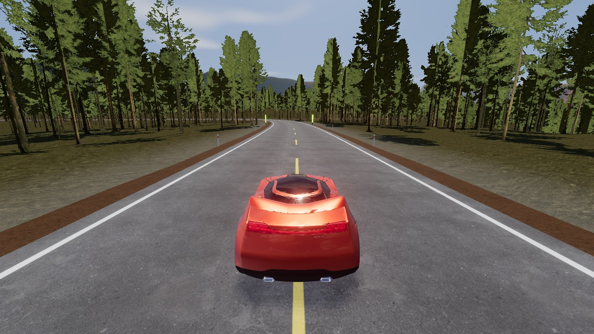
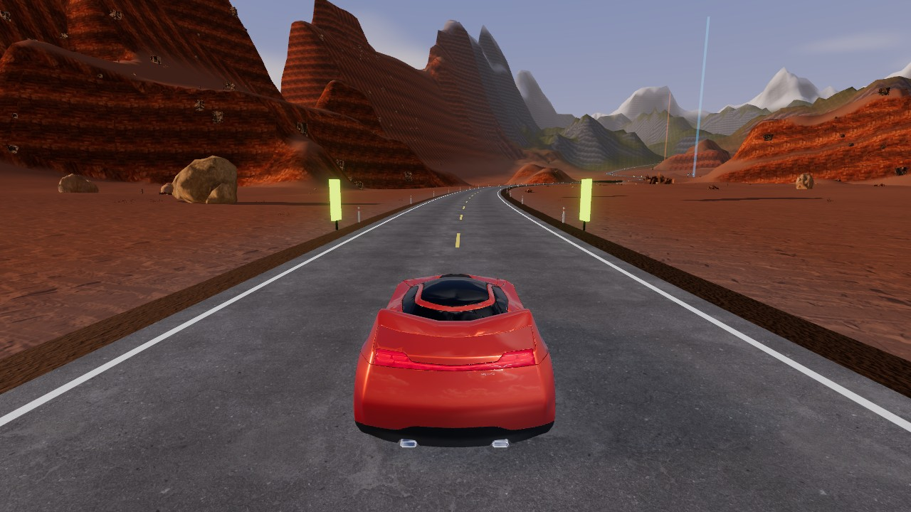
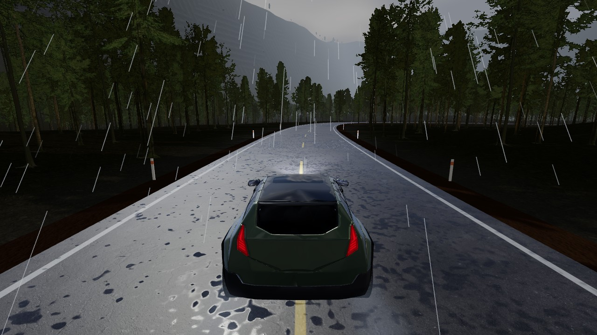
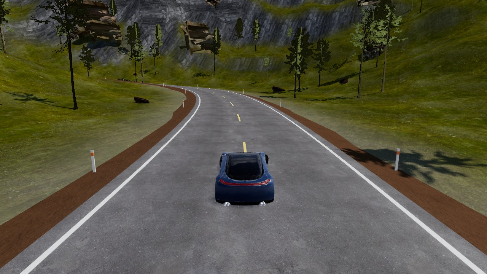
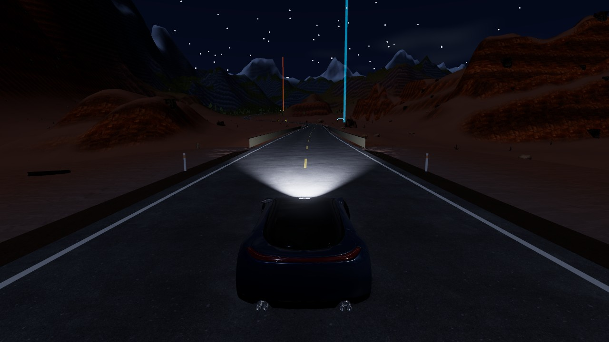

# Horizon — Open Roads

An open-world driving game that runs in a desktop browser. One connected map with a desert, a mountain pass and a pine forest, four cars with different handling, and eleven events.

**Play:** https://aimerscrypto.github.io/horizon-open-roads/







More in [docs/screenshots](docs/screenshots).

## Controls

| Key | Action |
| --- | --- |
| `W` `A` `S` `D` or arrow keys | Accelerate, steer, brake. Hold brake at a standstill to reverse |
| `Space` | Handbrake |
| `Shift` | Boost (recharges on its own) |
| `C` | Camera: chase, far chase, hood, cockpit |
| `R` | Reset the car onto the nearest road, or to the last checkpoint during an event |
| `Enter` | Start the event at a start gate |
| `M` | Events and map, with fast travel |
| `T` | Skip time forward two hours |
| `Esc` | Pause |

A gamepad also works: left stick, triggers, A for handbrake, X for boost.

## What is in the game

- **World.** A 12.7 km tarmac loop (Horizon Loop) and a 3.4 km dirt cut-through (Dust Devil Cut).
  - Desert: long sweepers between sandstone mesas, a bridge over Red Canyon.
  - Mountain: a climb through switchbacks to a 300 m summit tunnel, then a fast descent.
  - Forest: a winding road under pines with two river bridges; the dirt road adds a timber bridge.
- **Cars.**
  | Car | Class | Drive | Unlock |
  | --- | --- | --- | --- |
  | Kestrel S | Sports coupe | RWD | Starter |
  | Aurelia GT | Grand tourer | RWD | 30,000 CR |
  | Bastion X | Off-road SUV | AWD | 45,000 CR |
  | Vanta R | Exotic supercar | AWD | 90,000 CR |
- **Events.** Three road races, two time trials, three speed traps and three drift zones, spread over the three biomes. Each awards up to three stars, credits and XP. Speed traps and drift zones trigger as you drive through them; races and trials start at the glowing gates.
- **Day/night and weather.** A 24-minute day cycle and passing rain showers. Rain wets the tarmac, adds puddle reflections and cuts grip by about a fifth. Both can be fixed in Settings.
- **Saving.** Selected car, owned cars, paint, best results, stars, credits, XP and settings are kept in the browser's local storage.

## Graphics settings

Low, Medium and High presets are in Settings. The first run picks Low on integrated graphics and Medium otherwise. Resolution also scales down automatically when the frame rate drops.

| Preset | Shadows | Resolution cap | Extras |
| --- | --- | --- | --- |
| Low | Off (contact shadow under the car) | 0.7× | Shorter draw distances |
| Medium | 1024 px | 1× | Reflections on wet tarmac |
| High | 2048 px, terrain casts shadows | up to 1.5× | Bloom, 4× MSAA, road normal maps |

Measured on the development machine (Intel UHD integrated graphics, 1024×768): about 11 ms per frame on Low and 26–34 ms on Medium, in the forest.

## Build and run

Requires Node 20 or newer.

```bash
npm install
npm run dev        # http://127.0.0.1:5188
npm run build      # type-checks, then writes the static site to dist/
npm run preview    # serves dist/ on http://127.0.0.1:5189
```

The optimised assets are committed under `public/assets`, so the two asset scripts are only needed to rebuild them from source:

```bash
npm run assets:fetch   # downloads the source files into assets-src/ (about 100 MB)
npm run assets:prep    # simplifies meshes, converts textures to WebP, writes public/assets/
node scripts/prep-cars.mjs       # rebuilds the three Sketchfab cars from assets-src/cars/dl (download needs a Sketchfab account)
python scripts/prep-audio.py     # downloads and cuts the CC0 recordings (needs ffmpeg)
```

### Deploying

`dist/` is a plain static site with relative paths, so it can be hosted anywhere. The public copy is on GitHub Pages, published from the `gh-pages` branch:

```bash
npm run build
npm run deploy
```

## Tests

```bash
npx tsx scripts/sim.ts     # world statistics, then an AI driver laps every road in every car
npx tsx scripts/feel.ts    # launch, braking, handbrake and drift checks per car
```

In the browser console, `__qa.auto(seconds)` drives the current road automatically and `__qa.probe()` reports frame time and triangle counts.

## Project layout

```
src/core      asset loading, input, save data, noise helpers
src/world     map layout, road splines, terrain, props, road/bridge/tunnel meshes, sky and weather
src/vehicle   car specs, physics, procedural bodies, visual rig
src/game      camera, activities, audio, effects
src/ui        menus and HUD
scripts       asset pipeline and headless tests
```

The visual car models are separate from the physics model: each car is a rigid body with four raycast wheels, slip-angle tyres and an automatic gearbox, driving on a height field and the road splines.

## Assets and licences

See [ASSETS.md](ASSETS.md) for the full inventory.

- Vanta R: "Car Concept" by the Khronos Group (CC BY 4.0), based on a CC0 model by Unity Fan. Khronos logos removed.
- Kestrel S, Aurelia GT and Bastion X: concept cars 040, 002-02 and 006 by Unity Fan, released by the author as public domain.
- Rocks, plants, props, ground textures, the fir tree scan and the reflection HDRI: Poly Haven (CC0).
- Engine, tyre, wind, rain, bird, cricket and crash recordings: OpenGameArt and Freesound, all CC0.

## Known limitations

- **The look is realistic-leaning, not photoreal.** It has to run on integrated graphics, which rules out heavier materials, dense geometry and full-scene reflections.
- **Trees are billboards** baked from a photoscanned fir. They read well at driving speed but are flat up close.
- **The engine note is built from four short recorded loops** pitched by RPM, so all four cars share one engine character at different pitches.
- **Event star targets were set from AI lap times** and have not been tuned by human play.
- Desktop only. There are no touch controls.
- Crossing the river bed is possible but water has no effect on the car.
- Tunnel walls, bridge parapets and guardrails are collision limits along the road, not full meshes; hitting a bridge pier from below is not modelled.
